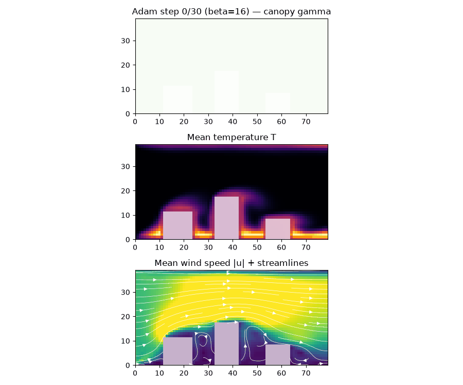
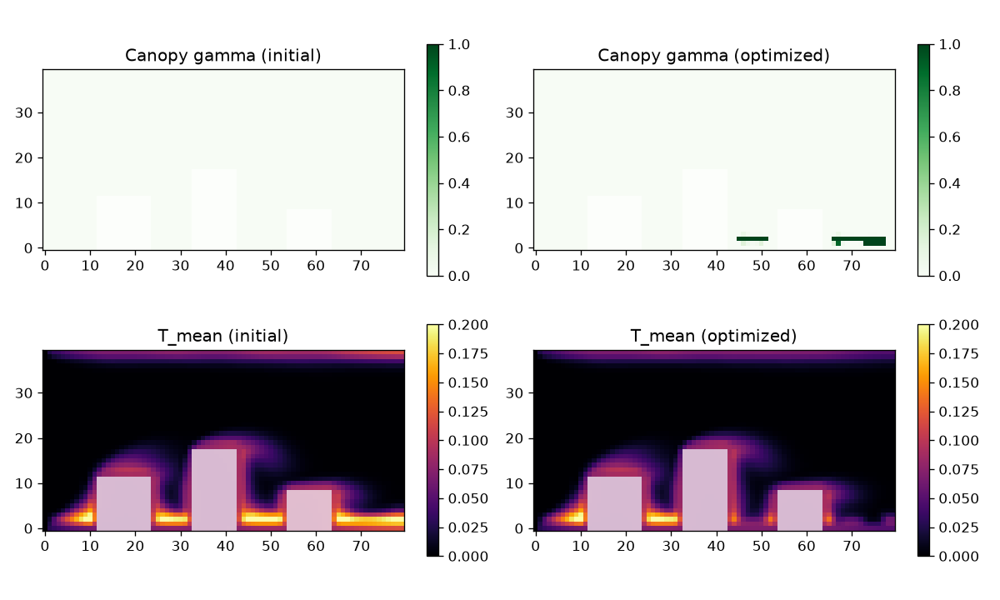
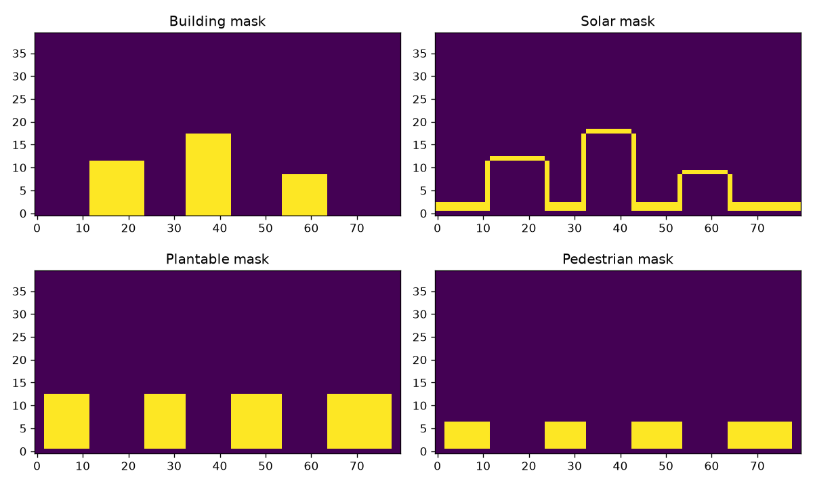
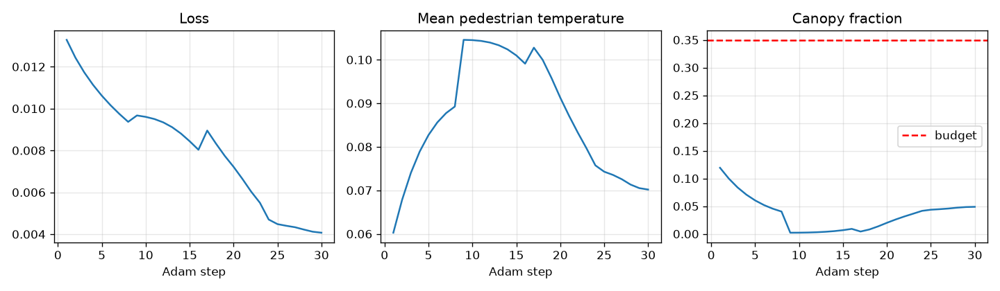

# UrbanCool-JAX

**Differentiable fluid–thermal Lattice Boltzmann engine for inverse urban microclimate design — in pure JAX.**

[](https://github.com/jax-ml/jax)
[](https://www.python.org)
[](LICENSE)
[]()

Instead of running one static CFD case at a time, UrbanCool-JAX differentiates through the whole coupled flow + heat simulation. State a pedestrian-comfort objective, and Adam automatically designs where tree canopy should go.





## What it does

- **Coupled thermal LBM** — D2Q9 momentum + D2Q5 temperature lattices, Boussinesq buoyancy via Guo forcing, solar heating and evaporative canopy cooling.
- **Smagorinsky LES** — local eddy viscosity from non-equilibrium moments, no finite-difference stencils, `sqrt(· + 1e-12)` everywhere so gradients never NaN at rest.
- **Differentiable tree canopies** — raw parameters → 3×3 smoothing → sigmoid (SIMP) density `γ ∈ [0, 1]`, acting as porous Brinkman–Forchheimer drag + latent cooling. An optional β continuation schedule (`2 → 4 → 8 → 16`) sharpens grey densities into crisp binary placements.
- **Cheap backprop through time** — non-differentiable burn-in (`stop_gradient`) + `jax.checkpoint`-wrapped `lax.scan` windows: O(√N) memory instead of O(N).
- **Real-world domains** — `urbancool.osm.domain_from_osm(lat, lon)` rasterises OpenStreetMap building footprints into a plan-view domain (optional `osm` extra; run plan-view cases with `g_buoy=0`).



## Results (80×40 canyon, 30 Adam steps, β schedule 2→4→8→16)

Before/after are both evaluated at the final β = 16.

| Metric | Before | After |
|---|---|---|
| Comfort loss | 0.00931 | **0.00404** (−57%) |
| Pedestrian temp | 0.103 | **0.070** (−32%) |
| Canopy fraction | 0.000 | 0.049 (budget 0.35) |

The final design is essentially binary: under 1% of plantable cells have grey density `γ ∈ (0.1, 0.9)`.



## Install

```bash
git clone https://github.com/Lulzx/urbancool-jax.git
cd urbancool-jax
python -m venv .venv && source .venv/bin/activate
pip install -e ".[dev]"
```

## Quick start

```python
import jax.numpy as jnp
from urbancool.grid import create_urban_canyon_domain
from urbancool.solver import ThermalLBMSolver, SimConfig
from urbancool.optimization import ComfortObjective, optimize_canopy_layout

config = SimConfig(u_inlet=0.06, nu_0=0.01, alpha_0=0.01)
domain = create_urban_canyon_domain(80, 40)
solver = ThermalLBMSolver(config, domain)
objective = ComfortObjective(t_target=0.15, u_max=0.10, canopy_budget=0.35)

theta, history = optimize_canopy_layout(
    solver=solver, objective=objective, theta_init=-jnp.ones((80, 40)),
    burn_in_steps=200, outer_steps=10, inner_steps=15,
    opt_steps=30, learning_rate=0.1, beta_schedule=(2, 4, 8, 16))
print(history["loss"][0], "->", history["loss"][-1])
```

Real neighbourhoods (plan view, needs `pip install "urbancool-jax[osm]"` and network):

```python
from urbancool.osm import domain_from_osm
domain = domain_from_osm(lat=51.512, lon=-0.126, dist=300, nx=120, ny=60)
config = SimConfig(g_buoy=0.0)  # plan view: no vertical buoyancy axis
```

## Demo & tests

```bash
python scripts/run_inverse_design.py   # artifacts/: summary JSON, design .npz, figures, evolution GIF
python -m pytest -q                    # 11 tests: invariants, thermal, FD-vs-grad (x64), domain import
```

Gradient quality is verified, not assumed — twice. The full-objective `jax.grad` matches central finite differences with cosine similarity > 0.999 (measured max relative error 4.3e-05), and a second physics-active check — budget/binarisation terms off, temperature term engaged, no burn-in truncation — verifies the gradient flowing through the LBM rollout itself (measured 2.1e-08). Figures under `docs/assets/` are copies of the demo script's `artifacts/` output.

## Layout

```text
urbancool/   lattice.py · grid.py · canopy.py · physics.py · solver.py · optimization.py · osm.py
scripts/     run_inverse_design.py
tests/       test_invariants.py · test_thermal.py · test_gradients.py · test_domain_import.py
docs/assets/ figures used above (generated by the demo script)
```

Full mathematical specification: [spec.md](spec.md).

## License

Apache-2.0 — see [LICENSE](LICENSE).
